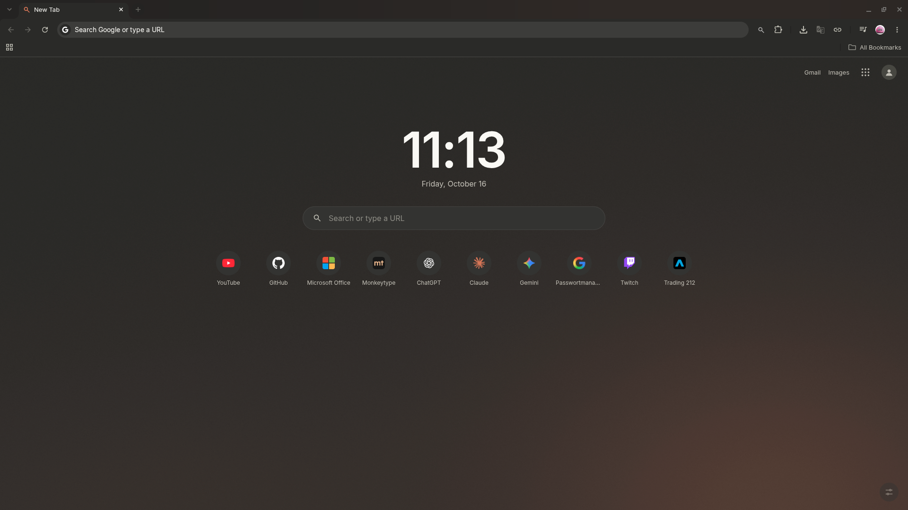
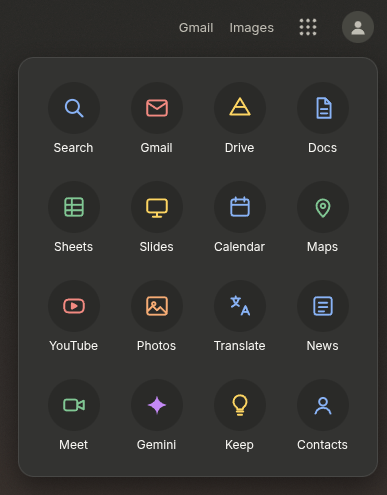
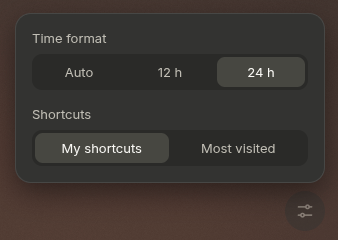

# Chrome-Theme

## Hintergrund und Entstehung

Eines Tages habe ich Google Chrome geöffnet und plötzlich war mein bisheriges Theme aus dem Chrome Web Store verschwunden. Ich habe im Web Store danach gesucht, aber es wurde offenbar gelöscht. Also habe ich nach Alternativen gesucht. Die vorhandenen Themes entsprachen allerdings nicht meinem Geschmack.

Deshalb habe ich mich dazu entschieden, mithilfe von Claude AI mein eigenes Theme zu entwickeln. Anfangs wollte ich eigentlich nur ein typisches Dark Theme erstellen. Da ich aber wissen wollte, was man mit Themes in Chrome alles machen kann, habe ich Claude einfach einmal ausprobieren lassen, was sich daraus machen lässt.

Das Ergebnis war ein Theme mit einem ziemlich cleanen Übergang. Allerdings ist mir mit der Zeit etwas aufgefallen, das mich zunehmend gestört hat: Die Suchleiste auf der New-Tab-Seite war weiterhin weiß. Sobald ich in das Suchfeld geklickt habe, öffnete sich außerdem ein riesiges weißes Feld. Wenn man sich erst einmal an den Dark Mode gewöhnt hat, fällt das ziemlich unangenehm auf.

Da sich das mit einem normalen Chrome-Theme nicht so umsetzen ließ, wie ich es mir vorgestellt hatte, entschied ich mich dazu, eine eigene New-Tab-Seite zu entwickeln. Dabei habe ich schnell gemerkt, dass sich damit deutlich mehr Möglichkeiten ergeben als mit einem gewöhnlichen Theme. Deshalb habe ich die Seite nach und nach komplett überarbeitet und um weitere Funktionen ergänzt.

**Hinweis zur Entwicklung:** Dieses Projekt wurde mithilfe von Claude AI entwickelt. Der Code wurde dabei von Claude generiert und im Verlauf der Entwicklung durch meine Vorgaben, Tests und Rückmeldungen iterativ weiterentwickelt. Die Umsetzung entstand also nicht durch vollständig manuelles Programmieren, sondern durch die Zusammenarbeit mit einer KI.

## Funktionen und Design

Im Laufe der Entwicklung habe ich unter anderem folgende Änderungen umgesetzt:

- **Uhr und Datum:** Das Google-Logo auf der New-Tab-Seite wurde durch eine Uhr mit Datum ersetzt.
- **Eigene Suchleiste:** Ich habe eine angepasste Suchleiste integriert, die zum restlichen Design passt.
- **Shortcuts:** Die Website-Verknüpfungen funktionieren jetzt wie vorgesehen. Außerdem kann man zwischen `My Shortcuts` und `Most Visited` wechseln.
- **Überarbeitete Menüs:** Die Elemente oben rechts wurden wiederhergestellt und das Menü mit den neun Punkten wurde mit eigenen Icons und einer übersichtlicheren Darstellung überarbeitet.
- **Einstellungen:** Über ein Menü unten rechts lässt sich das Uhrzeitformat ändern. Zur Auswahl stehen `Auto`, `12h` und `24h`.

## Entwicklung

Der Weg zum fertigen Ergebnis war nicht ganz problemlos. Anfangs gab es noch einige Fehler: Bei den Shortcuts wurden plötzlich völlig zufällige Webseiten angezeigt, die Suchleiste war bereits fokussiert, obwohl ich sie noch gar nicht angeklickt hatte, und die Elemente oben rechts waren teilweise verschwunden.

Durch mehrere Überarbeitungen und ungefähr 20 verschiedene Versionen ist daraus schließlich die aktuelle Version entstanden.

## Screenshots

### New-Tab-Seite

### Weitere Ansichten

